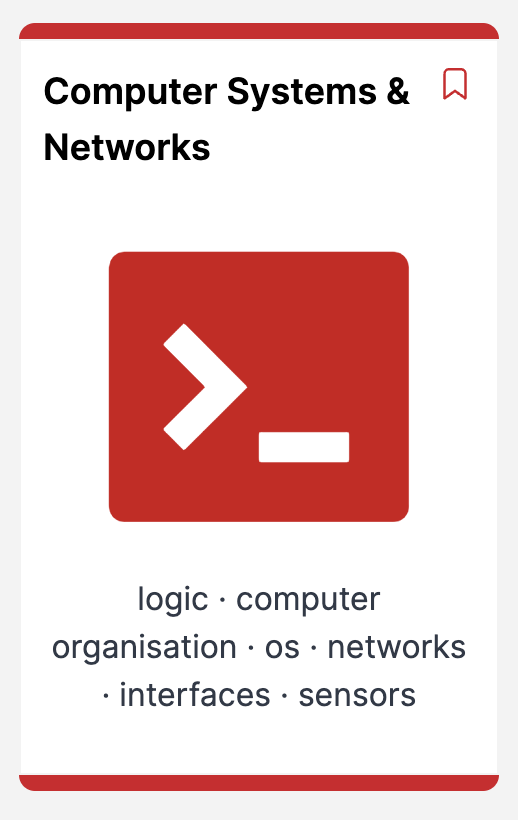
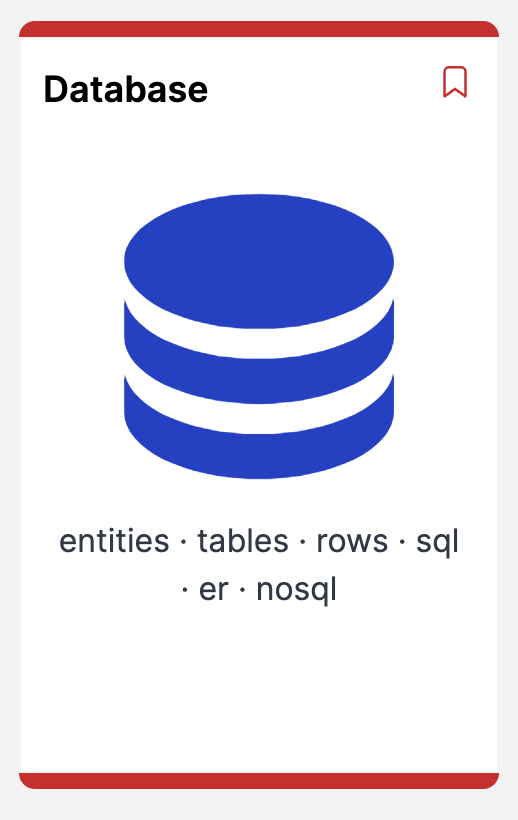

# Semester 2 schedule 2027

**11 Jan - 7 May 2027** · 12 teaching weeks · All times use Europe/Dublin.

**January On-Site: Friday 15 January 2027.**

Teaching starts on Monday 18 January. Teaching week 12 ends on Friday 7 May.

## Modules and delivery days

| Computer Systems & Networks | Database |
| --- | --- |
|  |  |
| 🔴 **Red: Monday and Wednesday** | 🔵 **Blue: Thursday** |

The colours match the printable calendar. Module names and weekdays also identify each delivery.

## Weekly schedule

| Teaching week | Monday | Friday | Schedule |
| --- | --- | --- | --- |
| - | 11 Jan 2027 | 15 Jan 2027 | January On-Site - Friday 15 January 2027 |
| 1 | 18 Jan 2027 | 22 Jan 2027 | First week of lectures - Waterford Campus. Computer Systems & Networks (Monday and Wednesday); Database (Thursday) |
| 2 | 25 Jan 2027 | 29 Jan 2027 | Computer Systems & Networks (Monday and Wednesday); Database (Thursday) |
| 3 | 1 Feb 2027 | 5 Feb 2027 | Computer Systems & Networks (Monday and Wednesday); Database (Thursday) |
| 4 | 8 Feb 2027 | 12 Feb 2027 | Computer Systems & Networks (Monday and Wednesday); Database (Thursday) |
| - | 15 Feb 2027 | 19 Feb 2027 | Reading Week |
| 5 | 22 Feb 2027 | 26 Feb 2027 | Computer Systems & Networks (Monday and Wednesday); Database (Thursday) |
| 6 | 1 Mar 2027 | 5 Mar 2027 | Computer Systems & Networks (Monday and Wednesday); Database (Thursday) |
| 7 | 8 Mar 2027 | 12 Mar 2027 | Computer Systems & Networks (Monday and Wednesday); Database (Thursday) |
| 8 | 15 Mar 2027 | 19 Mar 2027 | Computer Systems & Networks (Monday and Wednesday); Database (Thursday) |
| - | 22 Mar 2027 | 26 Mar 2027 | Easter Break |
| - | 29 Mar 2027 | 2 Apr 2027 | Easter Break |
| 9 | 5 Apr 2027 | 9 Apr 2027 | Computer Systems & Networks (Monday and Wednesday); Database (Thursday) |
| 10 | 12 Apr 2027 | 16 Apr 2027 | Computer Systems & Networks (Monday and Wednesday); Database (Thursday) |
| - | 19 Apr 2027 | 23 Apr 2027 | Reading Week |
| 11 | 26 Apr 2027 | 30 Apr 2027 | Computer Systems & Networks (Monday and Wednesday); Database (Thursday) |
| 12 | 3 May 2027 | 7 May 2027 | Computer Systems & Networks (Monday and Wednesday); Database (Thursday) |

Week ranges above show Monday to Friday. Weekends are not listed.

## Reading weeks and Easter

- Reading week: 15-19 February 2027.
- Easter break: 22 March-2 April 2027.
- Reading week: 19-23 April 2027.

## Assessments

Assessment dates and submission details will be added later.
